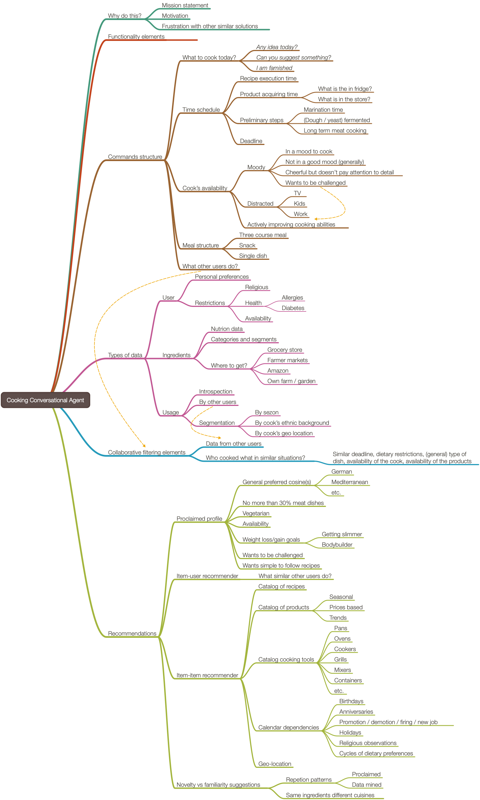
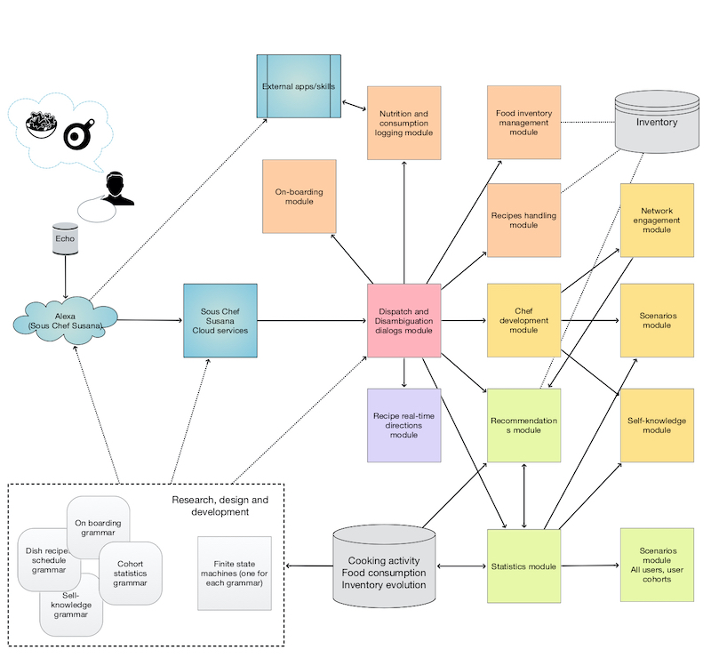

# Sous-chef Susana

## In brief

This project has documents and diagrams for design and implementation
of a conversational agent named “Sous-chef-Susana” aimed at facilitating 
of food preparation (cooking) activities. (See [Wk1].) 

**Remark:** More precisely, food preparation support and analysis.

Project's goal is to make a general component design and a more or less complete grammar
for the envisioned dialogs.

Here is a mind-map that outlines of the scope of the project:

 

Here is a diagram of the components of Sous Chef Susana:

----

## Related projects

There are two related projects:

- A dedicated one [SousChefSusana](https://github.com/sgizm/SousChefSusana) 
hosted by [sgizm (Sezin Yaman)](https://github.com/sgizm)
- Raku parser-interpreter ["DSL::English::FoodPreparationWorkflows"](https://github.com/antononcube/Raku-DSL-English-FoodPreparationWorkflows), [AAp1]
  - That parser-interpreter, in turn, uses the Raku packages:
    - ["DSL::Entity::Foods"](https://github.com/antononcube/Raku-DSL-Entity-Foods), [AAp2]
    - ["DSL::Entity::Geographics"](https://github.com/antononcube/Raku-DSL-Entity-Geographics), [AAp3]
  - Via those packages phrases like "Greek salad" can be parsed.

----

## Similarities with Glukoza
 
Sous Chef Susana is very similar to the conversational agent 
[Glukoza](../Glukoza)
in both component design and grammar design and elements.

----

## References

### Articles

[Wk1] Wikipedia, [Sous-chef](https://en.wikipedia.org/wiki/Sous-chef).

### Packages

[AAp1] Anton Antonov,
[DSL::English::FoodPreparationWorkflows, Raku package](https://github.com/antononcube/Raku-DSL-English-FoodPreparationWorkflows),
(2021-2022),
[GitHub/antononcube](https://github.com/antononcube).

[AAp2] Anton Antonov,
[DSL::Entity::Foods, Raku package](https://github.com/antononcube/Raku-DSL-Entity-Foods),
(2021-2023),
[GitHub/antononcube](https://github.com/antononcube).

[AAp3] Anton Antonov,
[DSL::Entity::Geogrpahics, Raku package](https://github.com/antononcube/Raku-DSL-Entity-Geographics),
(2021-2024),
[GitHub/antononcube](https://github.com/antononcube).

### Videos

[AAv1] Anton Antonov, 
["Voice-Grammar-Compute-Communicate: Take Control of Your Health Data"](https://www.youtube.com/watch?v=_rI1RxkeAcA),
(2018),
[Wolfram Channel at YouTube](https://www.youtube.com/channel/UCJekgf6k62CQHdENWf2NgAQ).